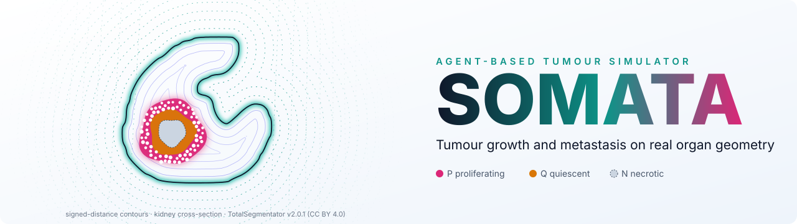
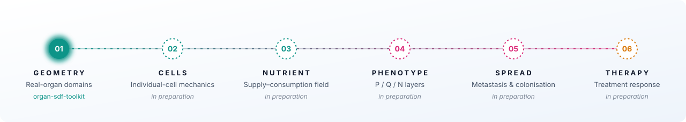

<picture>
  <source media="(prefers-color-scheme: dark)" srcset="assets/banner-dark.svg">
  <source media="(prefers-color-scheme: light)" srcset="assets/banner-light.svg">
  
</picture>

**SOMATA** is an agent-based model of solid-tumour growth. Individual cells grow, divide
and die inside real organ geometries and are fed by a nutrient field. Tumours develop
proliferating, quiescent and necrotic layers and can spread to secondary sites.

This account hosts the sub-projects that make up the SOMATA workflow. Each sub-project is
released as a self-contained, reproducible repository.

## Workflow

<picture>
  <source media="(prefers-color-scheme: dark)" srcset="assets/workflow-dark.svg">
  <source media="(prefers-color-scheme: light)" srcset="assets/workflow-light.svg">
  
</picture>

| Stage | Sub-project | Status |
|---|---|---|
| 01 Geometry | [**organ-sdf-toolkit**](https://github.com/SOMATA-JY/organ-sdf-toolkit) — organ segmentations (CT, MRI, meshes) → signed-distance-field domains | Released |
| 02 Cells | Individual-cell mechanics | In preparation |
| 03 Nutrient | Supply–consumption field | In preparation |
| 04 Phenotype | Proliferating / quiescent / necrotic layers | In preparation |
| 05 Spread | Metastasis and colonisation | In preparation |
| 06 Therapy | Treatment response | In preparation |

Banner: signed-distance contours of a kidney cross-section derived from the TotalSegmentator
dataset v2.0.1 (Wasserthal et al., <i>Radiology: Artificial Intelligence</i> 2023; Zenodo 10047263;
CC BY 4.0). The tumour layers are illustrative.
